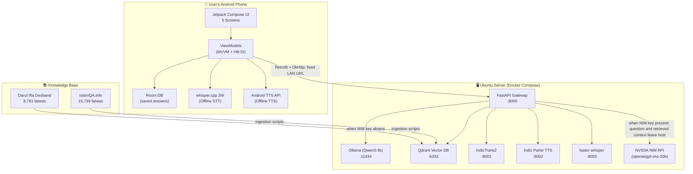
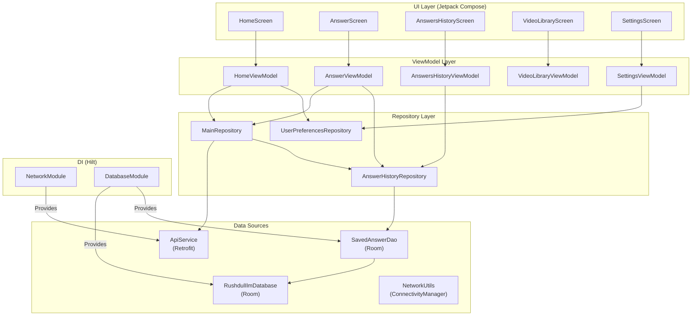
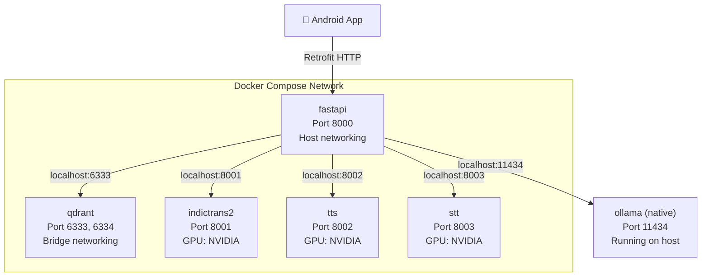
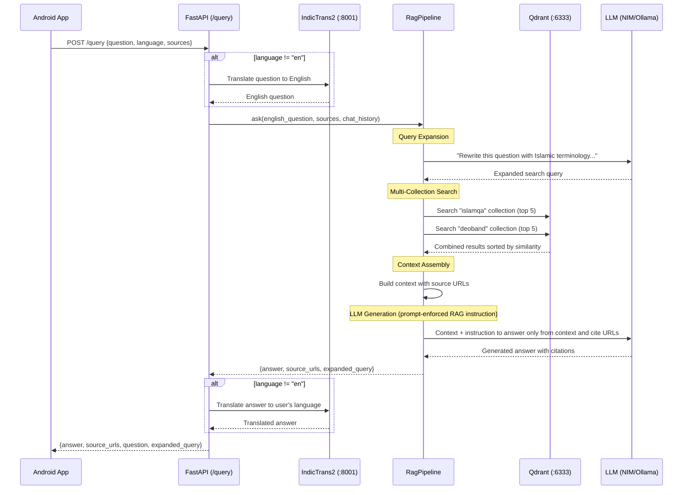
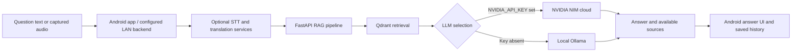

# 🏗️ System Architecture — Rushd-ul-Ilm

> Detailed technical architecture documentation for developers and contributors.

> **Implementation snapshot (audited 2026-11-18):** This document describes the code currently present, not the originally planned end state. Room stores saved answers only; on-device Q&A/FTS5 and Opus-MT inference are not implemented. The video list is mock data. Android backend URLs point to a fixed LAN address. The backend uses NVIDIA NIM only when `NVIDIA_API_KEY` is configured; otherwise it selects local Ollama. NIM errors do not automatically retry with Ollama.

---

## Table of Contents

- [System Overview](#system-overview)
- [Six-Layer Architecture](#six-layer-architecture)
- [Network and Offline Status](#network-and-offline-status)
- [Android App Architecture (MVVM)](#android-app-architecture-mvvm)
- [Backend Services (Docker Compose)](#backend-services-docker-compose)
- [RAG Pipeline Flow](#rag-pipeline-flow)
- [End-to-End Data Flow](#end-to-end-data-flow)
- [GPU Resource Constraints](#gpu-resource-constraints)
- [Technology Decision Matrix](#technology-decision-matrix)
- [Network Tier Detection](#network-tier-detection)

---

## System Overview



---

## Six-Layer Architecture

### Layer 1 — Android App (User Interface)
- **Technology**: Kotlin 2.x + Jetpack Compose (no XML)
- **Architecture**: MVVM + StateFlow + Hilt Dependency Injection
- **5 Screens**: Home (mic), Answer, Answers History, Video Library, Settings
- **Key Design**: Voice-first, 40%+ screen mic button, 48dp+ touch targets, bilingual labels

### Layer 2 — AI/NLP Services
- **STT**: faster-whisper (GPU) or whisper.cpp (on-device)
- **Translation**: IndicTrans2 service; its current device placement is inconsistent and needs runtime verification
- **TTS**: Indic Parler TTS (GPU) or Android TTS API (offline)
- **LLM**: NVIDIA NIM (`openai/gpt-oss-20b`) when the API key is configured; otherwise local Ollama (`qwen3:4b`). Failures do not trigger automatic fallback.

### Layer 3 — Islamic Knowledge Sources
- Scraped data is stored in source SQLite databases with metadata (title, question, answer, URL)
- Ingestion scripts generate 1,024-dimensional Qwen3-Embedding-0.6B vectors for Qdrant
- Source database row counts were verified during the audit; current live Qdrant counts were unavailable

### Layer 4 — RAG Pipeline
- **Framework**: LlamaIndex
- **Retrieval**: Multi-collection Qdrant semantic search
- **Generation**: Prompt instructs the model to answer only from provided context and cite source URLs; this is prompt-level, not a guarantee of valid citations
- **Enhancement**: Query expansion is implemented; backend accepts chat history, but the Android question flow does not populate it

### Layer 5 — Video Library Prototype
- Android currently displays five mock video records
- The video scraper is limited to YouTube channel URL metadata
- Transcription, indexing, downloads, and ExoPlayer playback are not wired

### Layer 6 — Backend
- Docker Compose defines FastAPI, Qdrant, IndicTrans2, Parler TTS, and faster-whisper; Ollama runs natively on the host
- NVIDIA NIM is an optional cloud service, not part of Docker Compose
- Compose uses host-mounted environments and local model directories; portability to a VPS is not established

---

## Network and Offline Status

The intended three-tier design is **incomplete**. Connectivity detection classifies the connection, but API, STT, and TTS endpoints are configured with a fixed LAN address; INTERNET detection does not currently select a public server.

| Capability | Server path | Offline path present in code |
|-----------|-------------|------------------------------|
| Speech-to-text | faster-whisper endpoint at configured backend | whisper.cpp JNI exists; native inference currently forces English |
| Translation | IndicTrans2 service; runtime device placement needs verification | No Opus-MT ONNX inference implementation |
| Text-to-speech | Indic Parler TTS endpoint | Android TextToSpeech is used when tier reports offline |
| Q&A retrieval | FastAPI + Qdrant + selected LLM | No offline fatwa index or offline answer pipeline |
| Video | Not implemented | Not implemented |

`ConnectivityManager` detection and a LAN reachability check inform the tier state, but this status must not be interpreted as complete Internet/LAN service routing.

---

## Android App Architecture (MVVM)



### Key Patterns
- **StateFlow**: All UI state is exposed via `StateFlow` from ViewModels
- **Sealed Classes**: `HomeUiState` uses sealed classes (Idle, Recording, Processing, NavigatingToAnswer, Error)
- **Repository Pattern**: ViewModels never directly access network or database
- **Hilt DI**: All dependencies injected at construction time
- **Resource wrapper**: Network calls return `Resource<T>` (Success, Error, Loading)

---

## Backend Services (Docker Compose)



### Service Details

| Service | Docker Image | Volumes | GPU | Notes |
|---------|-------------|---------|-----|-------|
| **fastapi** | Custom (python:3.13-slim) | `./:/app`, local_models, data folders | No | Host networking for Ollama access |
| **qdrant** | qdrant/qdrant:latest | qdrant_data (named) | No | Persistent vector storage |
| **indictrans2** | Custom (Python 3.13 image) | Host venv and model directories | NVIDIA | Runtime device placement needs verification |
| **tts** | Custom (Python 3.13 image) | Host venv and local model directories | NVIDIA | Indic Parler TTS |
| **stt** | Custom (Python 3.11 image) | Host venv | NVIDIA | faster-whisper service |
| **ollama** | Native (not Docker) | `~/.ollama` | Host-dependent | Used only when `NVIDIA_API_KEY` is absent |

### Backend Model Lifecycles

| Service | Loading and cleanup behavior |
|---------|------------------------------|
| **FastAPI / RAG** | A FastAPI lifespan creates `RagPipeline` at startup and clears the reference at shutdown. |
| **IndicTrans2** | Translation models are loaded on demand by direction into CPU memory, moved with their inputs to CUDA for inference, then moved back to CPU. The source hard-codes CUDA; runtime behavior has not been verified and there is no CPU fallback. |
| **Parler TTS** | The model and tokenizer load during service startup into CPU memory. The model moves to CUDA for inference and is returned to CPU afterward. |
| **faster-whisper STT** | The model is constructed inside each `/transcribe` request, then deleted and Python garbage collection is run after inference. Compose sets `LD_LIBRARY_PATH` for the mounted CUDA libraries. |

These are per-service strategies, not a shared GPU scheduler. The Compose commands use one Uvicorn worker per service; that does not prevent concurrent requests across different services from competing for GPU memory. Validate GPU and host-memory behavior on the target machine.

---

## RAG Pipeline Flow



The backend accepts chat history from API clients, but the current Android question flow does not populate that field. Prompt instructions and UI source links do not guarantee that each model answer contains a valid citation.

### RAG Safety Prompt (Simplified)
```
You are a helpful Islamic knowledge assistant.
Answer ONLY from the provided context below.
Do NOT use your own knowledge or training data.
Always cite the exact source URL at the end of your answer.
If the question is vague, ask a clarifying question.
If no relevant information is found, say:
"I could not find an answer in the approved Islamic sources.
 Please consult a qualified Islamic scholar."
```

---

## Implemented Online Data Flow



---

## GPU Resource Constraints

The target NVIDIA RTX 3050 has 4GB VRAM. Services have their own model-loading behavior, but the codebase does not establish a global scheduler that guarantees GPU-heavy translation, TTS, STT, and Ollama work can never overlap. Avoid claiming safe concurrent GPU operation until it is tested on the target machine. IndicTrans2 also has a source-level device-placement inconsistency that needs runtime verification.

---

## Network Tier Detection

```kotlin
// Simplified description; inspect NetworkUtils.kt for the current implementation
enum class NetworkTier { INTERNET, LAN, OFFLINE }

fun detectNetworkTier(context: Context): NetworkTier {
    val cm = context.getSystemService(ConnectivityManager::class.java)
    val network = cm.activeNetwork ?: return NetworkTier.OFFLINE
    val caps = cm.getNetworkCapabilities(network) ?: return NetworkTier.OFFLINE

    return if (pingServer("192.168.x.x", 8000, timeoutMs = 200)) {
        NetworkTier.LAN
    } else if (caps.hasCapability(NET_CAPABILITY_INTERNET)) {
        NetworkTier.INTERNET
    } else {
        NetworkTier.OFFLINE
    }
}
```

The app uses `ConnectivityManager.NetworkCallback` + `callbackFlow` for real-time reactive updates instead of polling.

---

## Technology Decision Matrix

| Decision | Chosen | Alternative Rejected | Why |
|----------|--------|---------------------|-----|
| Android UI | Jetpack Compose | XML layouts | Modern, declarative, Google's standard since 2021 |
| LLM | NVIDIA NIM or local Qwen3:4b (selected by key presence) | Other providers | Current optional NIM mode sends question and retrieved context to the cloud |
| Vector DB | Qdrant (self-hosted) | Pinecone, Weaviate | Self-hosted vector storage |
| RAG Framework | LlamaIndex | LangChain | Simpler API for our RAG use case |
| Translation | IndicTrans2 | Google Translate API | Privacy, self-hosted, best Indic language quality |
| TTS | Indic Parler TTS | Google TTS API | Self-hosted, natural Indian language voices |
| On-device STT | whisper.cpp (C++ JNI) | Google STT | Offline model is bundled; current JNI configuration forces English |
| HTTP Client | Retrofit + OkHttp | Ktor, Volley | Most popular Android HTTP client, best documentation |
| DI Framework | Hilt | Dagger, Koin | Google recommended, works well with Compose |
| Local DB | Room saved-answer storage | Firebase, Realm | Built-in Android storage for answer history |
| Backend Framework | FastAPI | Django, Flask | Fastest Python API, async, auto-generated docs |
| Orchestration | Docker Compose | Kubernetes, manual | Defines containerized services; host mounts and fixed endpoints limit portability |

---

> **Next**: See [DEVELOPMENT_STATUS.md](DEVELOPMENT_STATUS.md) for current build progress and known issues.

